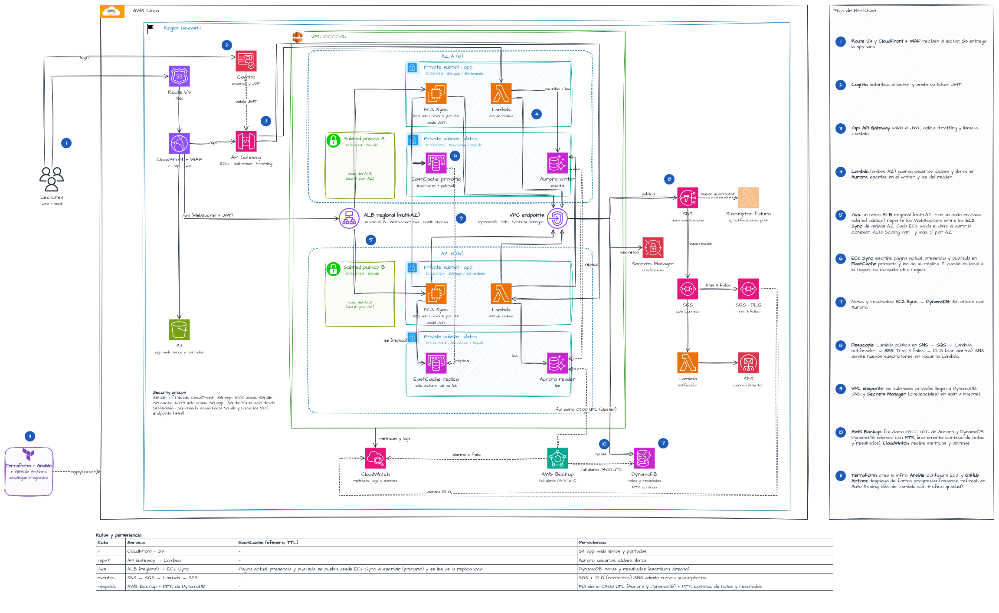

# BookHive — Infraestructura como Código

Sistema web de lectura sincronizada en tiempo real. Este repositorio contiene el PMV de la infraestructura en AWS.

## Diagrama de arquitectura



## Estructura de carpetas

```text
bookhive/
├── terraform/
│   ├── main.tf, variables.tf, outputs.tf, providers.tf, backend.tf
│   └── modules/
│       ├── network/        # VPC, subredes y endpoints
│       ├── security/       # Grupos de seguridad
│       ├── data/           # DynamoDB y Secrets Manager (Aurora opcional)
│       ├── auth/           # Cognito
│       ├── compute/        # ALB, Auto Scaling y EC2 Sync
│       ├── messaging/      # SNS, SQS, DLQ, Lambda notificador, SES y tema de alertas
│       ├── api/            # API Gateway y Lambda api_clubes
│       ├── backup/         # AWS Backup (full diario 09:00 UTC)
│       ├── observability/  # Alarmas y panel de CloudWatch
│       └── edge/           # CloudFront y WAF
├── ansible/             # Configuración de los EC2 Sync (roles y colecciones de Galaxy)
├── docs/                # Diagrama de arquitectura
└── .github/workflows/   # Automatización con GitHub Actions
```

- `terraform/`: infraestructura (módulos `network`, `security`, `data`, `auth`, `compute`, `messaging`, `api`, `backup`).
- `ansible/`: configuración de los servidores EC2 Sync.
- `.github/workflows/`: automatización con GitHub Actions.


## Observabilidad

- **Panel** `bookhive-dev-panel` en CloudWatch con widgets de ALB, API Gateway, Lambda, DynamoDB, Auto Scaling y cola de errores.
- **Alarmas** que avisan por correo a un tema SNS `bookhive-dev-alertas`: hosts no saludables, errores 5xx, latencia, errores y throttling de Lambda, cola de errores (DLQ), respaldo fallido y CPU alta (RNF-28: alerta en ≤ 5 minutos; RNF-17: alerta de respaldo en ≤ 15 minutos).
- **Logs** con retención de 30 días (RNF-29).
- **Agente de CloudWatch** en las EC2: memoria, disco y log de arranque.

## Configuración con Ansible

Las EC2 están en subredes privadas sin internet. El pipeline descarga la colección `ansible.posix` (versión 1.5.4) de Ansible Galaxy y la sube al bucket junto con los playbooks. El rol `red_websocket` la usa para ajustar el keepalive de TCP.

## Seguridad en el borde

CloudFront con WAF (reglas administradas de AWS y límite por IP) delante de la app web, la API y el WebSocket.

## Limitaciones conocidas del PMV

- Sin dominio propio: CloudFront usa su certificado por defecto (TLS mínimo 1.0) y el tramo CloudFront → ALB va por HTTP. No cumple del todo el RNF-23.
- El tema SNS de alertas usa el cifrado administrado de AWS. Se comprobó con una alarma de prueba que el correo llega.
- El servidor de sincronización real (WebSocket) está pendiente; hoy corre un servidor mínimo de demostración.