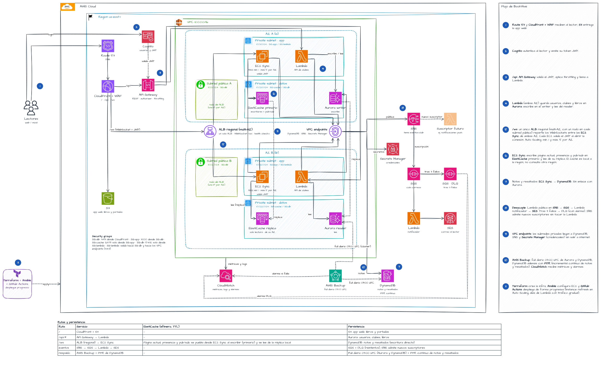

# BookHive — Infraestructura como Código

Sistema web de lectura sincronizada en tiempo real. Este repositorio contiene el PMV de la infraestructura en AWS.

## Diagrama de arquitectura



## Estructura de carpetas

```text
bookhive/
├── terraform/
│   ├── main.tf, variables.tf, outputs.tf, providers.tf, backend.tf
│   └── modules/
│       ├── network/     # VPC, subredes y endpoints
│       ├── security/    # Grupos de seguridad
│       ├── data/        # DynamoDB y Secrets Manager (Aurora opcional)
│       ├── auth/        # Cognito
│       ├── compute/     # ALB, Auto Scaling y EC2 Sync
│       ├── messaging/   # SNS, SQS, DLQ, Lambda notificador y SES
│       ├── api/         # API Gateway y Lambda api_clubes
│       └── backup/      # AWS Backup (full diario 09:00 UTC)
├── ansible/             # Configuración de los servidores EC2 Sync
├── docs/                # Diagrama de arquitectura
└── .github/workflows/   # Automatización con GitHub Actions
```

- `terraform/`: infraestructura (módulos `network`, `security`, `data`, `auth`, `compute`, `messaging`, `api`, `backup`).
- `ansible/`: configuración de los servidores EC2 Sync.
- `.github/workflows/`: automatización con GitHub Actions.